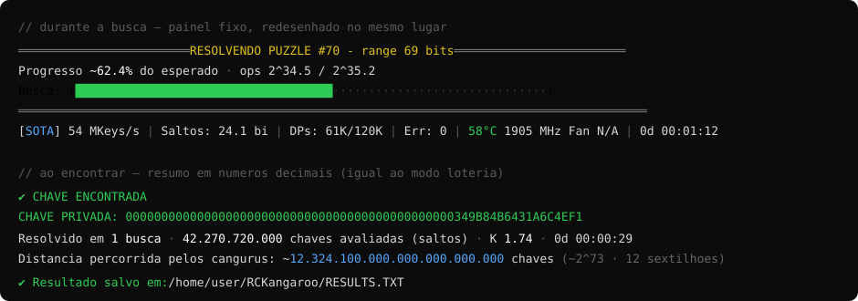

# RCKangaroo BR

Versão brasileira (PT-BR) do **RCKangaroo**, um solver de ECDLP para a curva secp256k1 usando o método **SOTA Kangaroo** (Pollard) com aceleração em GPU.

- **Base:** [RCKangaroo](https://github.com/RetiredC/RCKangaroo) — © 2024 **RetiredCoder (RC)**
- **Licença:** GPLv3 (software livre e de código aberto)
- **Fork BR por:** Tarcisio Soria (a.k.a **KKND**)



> ⚠️ **Projeto acadêmico.** Este fork foi desenvolvido como prova de conceito para um **TCC (Trabalho de Conclusão de Curso)**, com fins educacionais e de pesquisa. Resolver chaves fora dos desafios públicos (puzzles) é computacionalmente inviável — o objetivo aqui é demonstrar o método, a implementação em GPU e a telemetria.

---

## O que esta versão BR adiciona

Tudo do original, **traduzido para português**, mais:

- 🇧🇷 **Interface 100% em PT-BR** (banner, configuração, estatísticas e mensagens).
- 🎲 **Modo loteria** (`-rnd`): sorteia janelas aleatórias dentro do range e tenta resolver cada uma — útil para demonstrar a abordagem probabilística.
- 🧩 **Tabela de puzzles embutida** (`-puzzle N`): chaves públicas conhecidas dos puzzles Bitcoin (#50 a #160), verificadas na blockchain. Carrega range, início e pubkey automaticamente.
- 📊 **Painel ao vivo** fixo (redesenhado no lugar): régua + barra de progresso + telemetria da GPU (temperatura, clock, fan) com cores que respeitam o limite de throttle da própria GPU.
- 📈 **Resumo final em números decimais completos** (saltos avaliados, fator K, tempo e distância percorrida estimada), com escala em português (milhões, bilhões, … sextilhões).
- 💾 **`RESULTS.TXT` detalhado**: bloco completo por achado (com data/hora), incluindo chave pública comprimida, chave privada em hex (64 díg.), hex curto e **decimal**, além das estatísticas da busca. Mostra na tela o **caminho absoluto** onde salvou.
- 🛠️ **Makefile otimizado para Ampere** (RTX 30xx, `sm_86`), compilação nativa em Linux/WSL2 com CUDA.

---

## Parâmetros de linha de comando

### Novos nesta versão BR
| Opção | Descrição |
|---|---|
| `-rnd` | Ativa o **modo loteria** (sorteio de janelas aleatórias). Requer `-max` para desistir de uma janela errada e sortear outra. |
| `-wbits N` | Tamanho da janela em bits no modo loteria (mínimo 70). Deve ser **menor** que o range. |
| `-puzzle N` | Carrega o puzzle Bitcoin #N da tabela embutida (range, início e pubkey). Puzzles #50 a #160. |
| `-no-clear` | Não limpa a tela ao iniciar. |

### Originais
| Opção | Descrição |
|---|---|
| `-gpu` | Quais GPUs usar (ex.: `035` = GPUs #0, #3 e #5). Padrão: todas. |
| `-pubkey` | Chave pública a resolver (comprimida ou não). Sem ela, roda em modo benchmark. |
| `-start` | Offset inicial da chave, em hex. Obrigatório com `-pubkey`. |
| `-range` | Range da chave privada em bits (32…170). Obrigatório com `-pubkey`. |
| `-dp` | Bits de DP (14…60). Valores menores = DB maior, menos overhead. |
| `-max` | Limita o número de operações (ex.: `5.5` = 5.5·1.15·√range). |
| `-tames` | Arquivo de tames (gera com `-max` se não existir; carrega para acelerar). |

---

## Compilação (Linux / WSL2)

Requer CUDA (testado com CUDA 12.4) e uma GPU NVIDIA. O `Makefile` já está configurado para **Ampere (`sm_86`)**:

```bash
make
```

Para outras arquiteturas, ajuste `-gencode=arch=compute_XX,code=sm_XX` no `Makefile`.

---

## Exemplos

Resolver um puzzle direto (usa a tabela embutida):

```bash
./rckangaroo -puzzle 70
```

Modo loteria (lembre do `-max`):

```bash
./rckangaroo -puzzle 75 -rnd -wbits 73 -max 3
```

Resolver uma chave pública arbitrária (modo original):

```bash
./rckangaroo -dp 16 -range 84 -start 1000000000000000000000 -pubkey 0329c4574a4fd8c810b7e42a4b398882b381bcd85e40c6883712912d167c83e73a
```

> **Dica (GPU única):** rode apenas **um** `rckangaroo` por vez. Dois processos na mesma GPU disputam os recursos e a velocidade cai a zero.

---

## Sobre o método (SOTA Kangaroo)

O método SOTA atinge **K = 1.15**, o que significa ~1.8× menos operações (e memória para DPs) que o método clássico (K ≈ 2.1). Complexidade O(√n) contra O(n) da força bruta. Para detalhes técnicos e a pesquisa original, veja o [repositório do RetiredCoder](https://github.com/RetiredC) e a [thread de discussão](https://bitcointalk.org/index.php?topic=5517607).

---

## Créditos e licença

- Método, engine CUDA e implementação original: **RetiredCoder (RC)** — https://github.com/RetiredC/RCKangaroo
- Tradução PT-BR, modo loteria, tabela de puzzles, painel/telemetria e melhorias de saída: **Tarcisio Soria (KKND)**

Este software é distribuído sob a **GPLv3** (veja [`LICENSE.TXT`](LICENSE.TXT)). Por ser um derivado, este fork permanece GPLv3 e mantém os créditos ao autor original.
